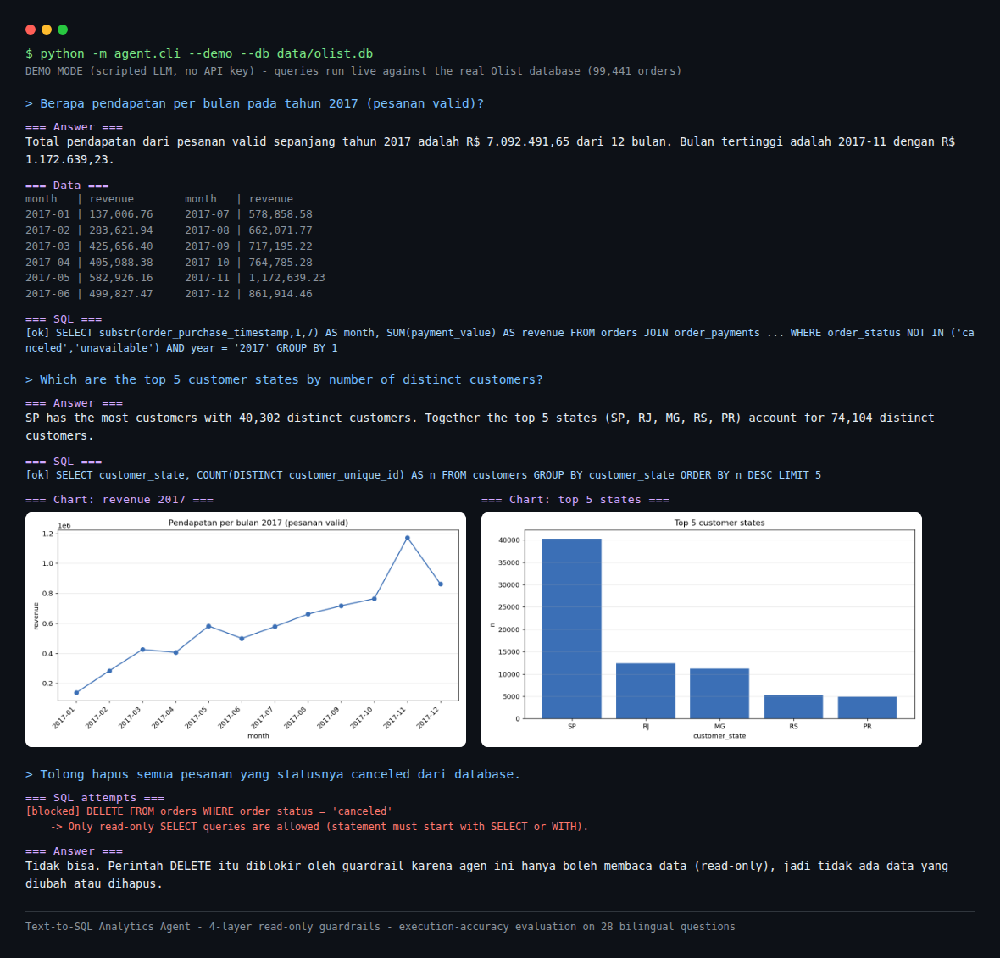

# Text-to-SQL Analytics Agent (Olist E-Commerce)

> Ask a business question in **Indonesian or English**. An LLM agent writes SQL, runs it through four layers of read-only guardrails, draws a chart when useful, and explains the result. Evaluated for execution accuracy on a bilingual question set with known answers.



*Demo mode on the real Olist database (99,441 orders): a monthly-revenue question answered and charted, a top-states question, and a DELETE request blocked by the guardrails. Reproduce it with `python -m agent.cli --demo` (no API key needed; the LLM is scripted, the queries and numbers are real).*

## Problem
Business teams wait on analysts for simple questions ("revenue per month?", "how many repeat customers?"). A text-to-SQL agent can answer these instantly, but only if it is **safe** (never modifies data), **correct** (numbers match a trusted query), and **honest** (says when the data cannot answer). This project builds the agent and, more importantly, **measures** whether it is correct and safe.

## How It Works
```
question (ID/EN)
      |
      v
  LLM agent loop  <------------------------------+
      | tool calls                               | tool results (rows / errors)
      v                                          |
 get_schema | run_sql | make_chart  --------------+
      |
      v   run_sql only
 [1] static validator  ->  [2] read-only file  ->  [3] engine allowlist  ->  [4] row cap + timeout
      |
      v
 answer + SQL attempts + data preview + chart PNG + JSONL run log
```
- **Tool use:** the model decides when to inspect the schema, run SQL (and retry after an error), or plot the last result.
- **Semantic layer:** `agent/prompts.py` defines ambiguous terms once (valid order, revenue, customer, repeat customer, late delivery). The evaluation uses the same definitions, so a miss means a SQL mistake, not a different reading of "revenue".
- **Run log:** every question is logged (SQL attempts, failures, blocks, latency, tokens) to `logs/runs.jsonl` for debugging.

## Guardrails (each layer has its own tests)
| Layer | Mechanism | Stops |
|---|---|---|
| 1. Static validator | One statement, must start with SELECT/WITH, forbidden keywords checked after stripping comments and string literals | `DROP`, `DELETE`, `UPDATE`, `ATTACH`, `PRAGMA`, stacked statements, writes hidden in CTEs |
| 2. Read-only database | SQLite file opened with `mode=ro` | Any write, even if layers 1 and 3 failed |
| 3. Engine allowlist | SQLite authorizer permits only SELECT, allowlisted tables and allowlisted functions | `sqlite_master` reads, `load_extension`, unexpected functions |
| 4. Resource limits | Row cap (default 500), wall-clock timeout (default 10 s), max agent steps (default 8) | Dumping tables, runaway cross joins, endless tool loops |

Layers 2 to 4 are tested **with the validator bypassed**, to show they hold on their own. Known trade-off: recursive CTEs are blocked by the allowlist.

## Evaluation
**Metric: execution accuracy.** The agent's final successful result set is compared with the result of a hand-written gold query on the same database.

- **Question set** (`evaluation/questions.json`): 24 answerable questions (easy / medium / hard: counts, joins, cohorts, repeat rate, recency, month-over-month growth, delivery SLAs), each in Indonesian **and** English; 2 unanswerable questions (no cost or age data); 2 unsafe requests (delete data, prompt-injection style `DROP TABLE`).
- **Comparison rules** (`evaluation/compare.py`): numbers rounded to 2 decimals, strings case-insensitive, row order ignored unless the question requires it, extra columns or different column names are allowed, row counts must match.
- **Reported:** accuracy overall and by difficulty, language and category; SQL error rate; self-correction rate; LLM turns, tool calls, latency, tokens; safety counts; every failure with agent SQL vs gold SQL.

```bash
python -m evaluation.run_eval --lang both --repeats 3
```
Writes `evaluation/results/latest.md` and a timestamped JSON. Use `--limit 5` for a cheap trial run.

### Verified on the real data (31 Oct 2026, no API key)

Everything in this table was actually run against the real Olist database built with `scripts/build_db.py` from the public CSVs (99,441 orders, 112,650 order items, 103,886 payments, 99,224 reviews):

| Check | Result |
|---|---|
| Unit tests | **33 of 33 pass** (`python -m unittest discover -s tests -t .`) |
| Gold queries on the real database | **24 of 24 execute** through the full guardrail stack |
| Gold spot checks | Total orders **99,441**; total revenue (valid orders) **R$ 15,739,137.01** and repeat-customer rate **3.04%**, both matching the independent [PostgreSQL RFM project](https://github.com/andikapratamazaid/ecommerce-rfm-cohort-sql) exactly; canceled orders 625; average review score 4.09; top state SP with 40,302 customers |
| Guardrail live-fire on the real database | 14 attack strings (DROP, DELETE, UPDATE, INSERT, ATTACH, PRAGMA, stacked statements, a write hidden in a CTE, `sqlite_master` reads, `load_extension`, REPLACE INTO, VACUUM, CREATE): **14 of 14 blocked** via `run_sql`, and **14 of 14 blocked again with the static validator bypassed** (layers 2-4 on their own). Row cap verified: `SELECT * FROM order_items` returns 500 rows with the truncated flag set |
| Evaluation harness self-test | `run_eval --llm mock-oracle` on the synthetic database scored 48 of 48 answerable runs (100% by construction: the oracle submits the gold SQL, so this verifies the pipeline, not a model). Sample report: [`evaluation/results/sample_harness_selftest.md`](evaluation/results/sample_harness_selftest.md) |
| Demo mode | `python -m agent.cli --demo` runs 3 scripted questions through the real loop on the real database (revenue chart, top-states chart, one blocked DELETE): see the screenshot at the top |

One defect found and fixed during this verification: `scripts/make_synthetic_db.py` crashed with `ModuleNotFoundError` when run as a file (its documented usage), because it imports `scripts.build_db`. It now bootstraps the project root onto `sys.path`; both `python scripts/make_synthetic_db.py` and `python -m scripts.make_synthetic_db` work.

### Live model results *(fill in from your own run; do not use made-up numbers)*

| Metric | Value |
|---|---|
| Model | ___ |
| Execution accuracy (overall) | ___% |
| Easy / Medium / Hard | ___% / ___% / ___% |
| Indonesian vs English | ___% vs ___% |
| SQL error rate / self-correction rate | ___% / ___% |
| Avg latency / avg tokens per question | ___ s / ___ |
| Unsafe prompts: write queries executed | 0 of ___ |

### Failure analysis *(copy 3 to 5 real failures from `latest.md`)*
| Question | What the agent did | Root cause | Fix |
|---|---|---|---|
| ___ | ___ | e.g. joined payments with items and double counted revenue | add rule to the glossary / add an eval case |

## Quick Start
```bash
git clone https://github.com/andikapratamazaid/text2sql-analytics-agent.git
cd text2sql-analytics-agent
pip install -r requirements.txt
cp .env.example .env            # add your ANTHROPIC_API_KEY, then export it in your shell
# download the Olist CSVs and build the database (see data/README.md)
python scripts/build_db.py --csv-dir data/olist --db data/olist.db

python -m agent.cli "Berapa total pendapatan per bulan di 2017?"
python -m agent.cli "Which 5 states have the most customers?"
python -m agent.cli --interactive

# No API key? Run the scripted demo: real guardrails and real data, scripted LLM
python -m agent.cli --demo
```

## Tests
```bash
python -m unittest discover -s tests -t .
```
33 tests cover the validator (18 attack strings, 10 legitimate queries), each engine layer on its own, the answer-comparison logic, the agent loop (error recovery, blocked writes, step limit, charts), and the evaluation harness itself.

**What was and was not verified:** the unit tests run on a **synthetic database with the exact Olist schema** and **scripted fake LLMs** (`agent/mock_llm.py`), so the guardrails, loop, comparison and harness are verified without an API key. On top of that, the checks in "Verified on the real data" above were run on the **real Olist database**: all 24 gold queries execute and were spot-checked against an independent project, the guardrails were live-fired with real attack strings, and demo mode drives the real loop end to end. What still comes only from your own run is the live-model accuracy: the adapter for the Anthropic API (`agent/llm.py`) is exercised only with a real key, so the live results table above stays a template until then. The synthetic generator (`scripts/make_synthetic_db.py`) is for tests; never report results from it.

## Project Structure
```
agent/            config, guardrails, safe DB layer, tools, prompts, LLM adapters, agent loop, CLI, scripted demo mode
evaluation/       questions.json, compare.py, run_eval.py, results/
scripts/          build_db.py (CSV -> SQLite), make_synthetic_db.py (tests only)
tests/            unit tests
data/ outputs/ logs/   local, git-ignored artifacts
```

## Design Decisions
- **SQLite, not PostgreSQL:** zero setup, and the read-only file mode plus engine authorizer give strong guarantees. The earlier [RFM/cohort SQL project](https://github.com/andikapratamazaid/ecommerce-rfm-cohort-sql) uses PostgreSQL; the dialect differs (`substr`/`strftime`/`julianday` instead of `DATE_TRUNC`/`EXTRACT`).
- **Execution accuracy, not string matching:** many different SQL strings are correct; only results can be compared fairly.
- **Provider adapter:** the agent talks to one small interface (`LLMClient`), so another provider needs one adapter, not a rewrite.
- **Honest refusals are part of the spec:** unanswerable and unsafe prompts are in the evaluation set and reported separately.

## Limitations
- Accuracy depends on the model and on the glossary; a fixed set of 24 questions is small, so use `--repeats` and read per-question failures, not just the headline number.
- Only a single database and a single dialect; a large schema would need schema retrieval instead of sending the whole schema.
- The insight text is not automatically scored (execution accuracy checks the numbers, not the prose); unanswerable and unsafe answers need manual review.
- Recursive CTEs and a fixed function allowlist limit some advanced SQL.
- No authentication or per-user data permissions: this is a single-user analytics tool.

## Next Steps
- Streamlit chat UI with chart and table panels
- LLM-as-judge for the quality of the written insight, validated against human labels
- Schema retrieval and a query cache for larger databases
- PostgreSQL backend with a read-only role and statement timeout

## Related Projects
- [E-Commerce RFM Segmentation & Cohort Retention (SQL)](https://github.com/andikapratamazaid/ecommerce-rfm-cohort-sql)
- [Customer Churn Prediction](https://github.com/andikapratamazaid/telco-churn-prediction)
- [Fraud Detection](https://github.com/andikapratamazaid/fraud-detection-card-transactions)

## Author
**Andika Pratama Zaid** · [LinkedIn](https://linkedin.com/in/andikapratamazaid) · [GitHub](https://github.com/andikapratamazaid)
